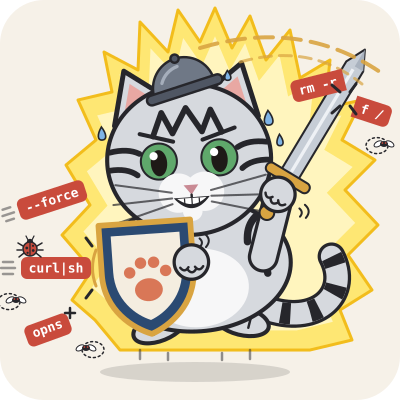

<p align="center">
  <picture>
    <source media="(prefers-color-scheme: dark)" srcset="assets/logo-dark.svg">
    
  </picture>
</p>

<h1 align="center">milo-guards</h1>

<p align="center">Guards for AI agents working on your own machine.</p>

## Introduction

An AI agent on your machine runs shell commands, reads and writes files and
fetches pages. Most of that is fine. Some of it is not: a `rm -rf` one folder
too high, a `cat` of your SSH key, a fetch of the cloud metadata service.
Something has to say which is which before it happens, and fast enough that
the agent does not stall on every step.

That is what a guard does. You hand it what the agent is about to do and the
places the agent works in, and it answers in microseconds: safe to do without
asking, or risky, with the reason in a few plain words a permission prompt can
show.

| The agent is about to run | The answer |
| --- | --- |
| `cargo build && rm -rf target`, inside the project | safe |
| `rm -rf ~` | risky: `delete`, "deletes your home directory" |
| `cat ~/.ssh/id_ed25519` | risky: `read_secret`, "reads your SSH keys" |
| `./script.sh` | cannot be told, so it is not called safe |

The guards are built for agents that run with small local models, so they ask
nothing of a model and nothing of the network. A guard is a plain function. It
runs offline, reads no file and no environment variable, and gives the same
answer for the same input on every machine.

### What a guard is not

- **Not a sandbox.** A guard does not run the command and does not stop it.
  Whatever you let through runs with all your rights.
- **Not a decision.** A guard reports. Whether to ask, refuse or allow is your
  policy, and you can choose differently for each rule.
- **Not a proof.** Safe means no rule found anything. What a guard cannot read
  at all, such as a program known only when the line runs or a line too deep to
  parse, comes back risky, never safe.

## Install

milo-guards is a Rust library. It is not on crates.io yet, so depend on it by
git, pinned to a commit:

```toml
[dependencies]
milo-guards = { git = "https://github.com/camiloazula/milo-guards", rev = "<commit>" }
```

Each guard sits behind a cargo feature. `shell`, `file`, `url` and `code` are
on by default; `secrets` is opt in, because most callers want the others and
not a table of credential patterns in their binary.

```toml
# Everything, the secrets guard included
milo-guards = { git = "https://github.com/camiloazula/milo-guards", rev = "<commit>", features = ["secrets"] }

# Only the shell guard
milo-guards = { git = "https://github.com/camiloazula/milo-guards", rev = "<commit>", default-features = false, features = ["shell"] }
```

It needs Rust 1.99 or newer. If your program also links tree-sitter, it has
to be on the 0.26 runtime: tree-sitter allows one version per lockfile, and
the guards are on 0.26.

A command-line program for callers that are not written in Rust is planned,
with npm and Homebrew packages. Until it ships, the library is the way in.

## Features

Four guards and a reader. Each guard takes one thing the agent is about to do
and the `Paths` it works in, and returns an `Assessment`: `Safe`, or `Risky`
with a `Finding` for each reason.

| Guard | Judges | Risky, for example | Safe, for example | Feature |
| --- | --- | --- | --- | --- |
| **shell** | one shell line: POSIX shell, PowerShell or cmd | `rm -rf ~` (`delete`) | `ls src` | `shell`, on by default |
| **file** | one read or write of one path through a file API | reading `~/.ssh/id_ed25519` (`read_secret`) | writing `src/main.rs` | `file`, on by default |
| **url** | one URL the agent is about to fetch | `http://2130706433/`, which is `127.0.0.1` (`local_address`) | `https://docs.rs/url` | `url`, on by default |
| **secrets** | a text, for the credentials and personal data in it | `postgres://app:fakePass0word1@db/app` (`connection_string`) | a commit SHA | `secrets`, opt in |

The **code** reader is not a guard. It reads Python and JavaScript (Node, Bun
and Deno) and says what the code is certain to do: the files it deletes,
writes, reads and moves, and the programs it starts. The shell guard uses it
for the code a line hands to an interpreter, so `python3 -c "import shutil;
shutil.rmtree('/home/me')"` is judged as the delete it is, and
`python3 -c 'print(1)'` is safe. Code the reader does not understand in full is
never taken for harmless.

What sets the guards apart:

- **Structure, never text.** The shell guard parses the line with tree-sitter
  and judges the programs, flags, operands and redirects it finds. There is no
  pattern match on the raw line to slip past.
- **Spelling-proof.** A path is placed by how it is spelled, with `~`, `..`,
  Windows drives, shares, short names and any case, without touching the disk.
  A URL is judged by the host a WHATWG parser reads, so a decimal, octal or
  IPv6-mapped spelling of a local address is still local.
- **Two more answers from the shell guard.** `effect` says whether a line only
  reads, changes something or cannot be told, and whether its reads stay in the
  workspace. `explain` shows how the line was read, unit by unit, with what
  each unit found.
- **Your own files, in your own words.** Name the paths your tool keeps for
  itself, such as its settings or its rules, as protected. A finding about
  them says "deletes the agent's settings", in the words you gave.
- **No secret in a finding.** The secrets guard reports a masked target such as
  `… (14 chars)` and the byte ranges of what it found, so you can scrub the
  text before it goes anywhere.
- **Stable rules.** Every finding carries a rule with a wire name that never
  changes once published. The rule enums are exhaustive, so a new rule breaks
  your `match` at compile time, where you decide what to do with it.

### The rules a finding can carry

| Guard | Rules, by wire name |
| --- | --- |
| shell | `delete`, `wipe_disk`, `overwrite`, `git_discard`, `git_remote`, `git_history`, `permissions`, `system_settings`, `read_secret`, `elevated`, `run_downloaded`, `run_input`, `stop_system`, `stop_unknown`, `send_secret`, `drop_data`, `destroy_resources`, `unknown`, `unreadable` |
| file | `read_secret`, `write_outside`, `write_sensitive`, `write_protected`, `network_share`, `unreadable` |
| url | `local_address`, `metadata`, `credentials`, `local_file`, `scheme`, `unreadable` |
| secrets | `private_key`, `cloud_key`, `api_key`, `jwt`, `basic_auth`, `bearer_token`, `connection_string`, `url_credentials`, `generic_secret`, `credit_card`, `government_id`, `email`, `phone`, `public_ip` |

What each rule covers is documented on the guard's `Rule` enum, and in depth
on its design page: [shell](docs/design/shell.md), [file](docs/design/file.md),
[url](docs/design/url.md) and [secrets](docs/design/secrets.md).

### The promises

Every guard keeps five promises, and the test suite enforces them. How is in
[the architecture page](docs/design/architecture.md#the-contract).

1. **No I/O and no environment.** A guard never reads a file, a variable, the
   clock or the network, and never starts a process.
2. **Deterministic.** The same input gives the same answer, on every run and on
   every machine.
3. **No policy.** A guard says what it found. It has no modes and never decides
   for you.
4. **What cannot be read is risky.** A guard never answers safe because it gave
   up.
5. **Never panics.** Whatever the input, a guard returns. It runs on every
   action an agent takes, and a panic there would fail the agent's turn.

## How to use

Build the `Paths` once: the agent's working directory, the user's home and the
folders the agent may change. Then ask a guard about each thing the agent is
about to do. This example is compiled and run with the tests, so it is as
current as the code.

```rust
use milo_guards::file::{judge, Access};
use milo_guards::shell::{classify, effect, Effect, Reach, Shell};
use milo_guards::{Paths, Protected};

// Where the agent works, and what your tool keeps for itself.
let paths = Paths::new("/home/me/work/app", "/home/me", ["/home/me/work/app"])
    .with_protected([Protected::folder("/home/me/.agent", "the agent's settings")]);

// Inside the workspace, building and cleaning are the agent's own business.
assert!(classify("cargo build && rm -rf target", Shell::Posix, &paths).is_safe());

// Beyond it, the answer says what the line would do.
let verdict = classify("rm -rf ~", Shell::Posix, &paths);
for finding in verdict.findings() {
    // Ask, refuse or let it through: that part is yours.
    println!("{}: {}", finding.rule.name(), finding.reason);
}
assert_eq!(verdict.findings()[0].rule.name(), "delete");
assert_eq!(verdict.findings()[0].reason, "deletes your home directory");

// Your own files get your own words.
let verdict = classify("rm ~/.agent/config.yaml", Shell::Posix, &paths);
assert_eq!(verdict.findings()[0].reason, "deletes the agent's settings");

// Whether a line only reads, and whether those reads stay in the workspace.
assert_eq!(effect("git status", Shell::Posix, &paths), Effect::ReadsOnly(Reach::Workspace));
assert_eq!(effect("cat ~/.ssh/id_ed25519", Shell::Posix, &paths), Effect::ReadsOnly(Reach::Beyond));
assert_eq!(effect("./script.sh", Shell::Posix, &paths), Effect::Unknown);

// One read or write through a file API, judged against the same places.
assert!(judge(Access::Write, "src/main.rs", &paths).is_safe());
let verdict = judge(Access::Read, "~/.ssh/id_ed25519", &paths);
assert_eq!(verdict.findings()[0].reason, "reads your SSH keys");
```

The other guards read the same way. `url::judge(url, &paths)` judges a URL,
`secrets::find(text)` reads a text and `secrets::find_spans(text)` gives the
byte ranges to scrub, and `code::read` and `code::understand` read a snippet of
Python or JavaScript. Every example in the crate's documentation is a test too;
`cargo doc --open` shows them all, one per guard.

A finding has three fields: `rule`, the enum value with its wire name; `reason`,
the words to show; and `target`, what the finding is about, when there is one.
A finding about a secret never holds the secret.

If a guard calls a harmless line risky, that is a bug: open an issue. If it
calls a line safe that deletes, overwrites or sends something beyond the
workspace, or runs something the line does not show, report it privately as
[SECURITY.md](SECURITY.md) describes.

To go further: the design pages in [docs/design](docs/design/) say how each
guard reads its input, [GUIDELINES.md](GUIDELINES.md) holds the rules the code
follows, and [CONTRIBUTING.md](CONTRIBUTING.md) says how to build, test and
submit a change.

## License

Copyright (c) 2026 Camilo Azula. Licensed under either of the
[Apache License, Version 2.0](LICENSE-APACHE) or the [MIT license](LICENSE-MIT),
at your option.

Unless you explicitly state otherwise, any contribution intentionally submitted
for inclusion in the work by you, as defined in the Apache-2.0 license, shall be
dual licensed as above, without any additional terms or conditions.
